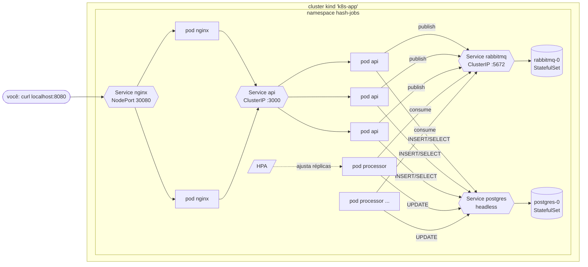
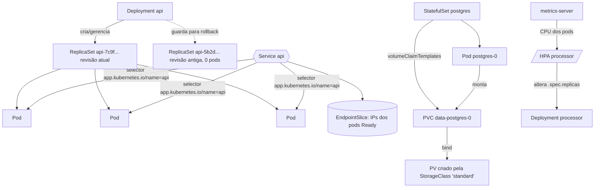

# Arquitetura

## 1. O que o sistema faz

Um **gerador de hashes assíncrono**:

1. O cliente faz `POST /jobs {"input": "abc", "rounds": 5}`.
2. A API grava o job no Postgres (`status=pending`), publica `{id}` na fila do RabbitMQ e responde **202** na hora.
3. Uma réplica do **processor** pega a mensagem, calcula bcrypt (custo 12) encadeado `rounds` vezes (trabalho pesado de CPU) e grava o resultado (`status=done`).
4. O cliente consulta `GET /jobs/:id`.

A fila desacopla quem **recebe** (API, rápida) de quem **processa** (worker, lento). Se chegarem 1000 jobs de uma vez, a API não trava: as mensagens esperam na fila e o HPA aumenta o número de processadores.

## 2. Visão geral no cluster



Repare que **não existe seta entrando no processor**. Por isso ele não tem Service.

## 3. Os componentes e por que cada um é assim

| Componente | Objeto k8s | Réplicas | Service | Por quê |
|---|---|---|---|---|
| nginx | Deployment | 2 | NodePort | Stateless. É a porta de entrada do cluster. |
| api | Deployment | 3 | ClusterIP | Stateless. Só é acessada de dentro do cluster (pelo nginx). |
| processor | Deployment + HPA | 1 a 6 | **nenhum** | Só faz conexões de saída. Escala por CPU. |
| rabbitmq | **StatefulSet** | 1 | headless + ClusterIP | Tem estado em disco e depende de hostname fixo. |
| postgres | **StatefulSet** | 1 | headless | Tem estado em disco. |
| migration | **Job** | roda 1 vez | — | Tarefa que termina, não serviço contínuo. |

### Stateless × Stateful (o ponto mais importante)

- **Stateless** (api, nginx, processor): o pod não guarda nada que importe. Matou um, sobe outro igual em qualquer node e ninguém percebe. → **Deployment**.
- **Stateful** (postgres, rabbitmq): o pod tem dados em disco e uma identidade. → **StatefulSet**, que dá:
  - **nome fixo**: `postgres-0` continua `postgres-0` depois de recriado;
  - **disco próprio e persistente**: o PVC `data-postgres-0` não é apagado quando o pod morre; o novo `postgres-0` monta o mesmo disco;
  - **DNS por pod**: `postgres-0.postgres.hash-jobs.svc.cluster.local` (via headless Service);
  - **ordem**: sobe 0, depois 1, depois 2...

> O RabbitMQ deixa isso bem visível: ele salva os dados numa pasta chamada `rabbit@<hostname>`. Num Deployment o hostname seria aleatório a cada pod novo, e as filas "sumiriam".

### A cadeia de objetos



**Labels e selectors são a cola de tudo.** Deployment acha seus pods por label, o Service acha seus pods por label, o PDB e o `topologySpreadConstraints` também. Errar um label = Service sem endpoints = `502` no nginx.

## 4. O caminho de uma request

1. `curl localhost:8080` → o Docker do Mac encaminha para a porta **30080** do container do node do kind (`extraPortMappings` em `k8s/kind-config.yaml`).
2. **NodePort 30080**: o kube-proxy desse node manda para um pod **nginx** (pode estar em outro node).
3. O nginx faz `proxy_pass http://api:3000`. O **CoreDNS** resolve `api` para o **ClusterIP** do Service (IP virtual que nunca muda).
4. O kube-proxy traduz o ClusterIP para o IP de um **pod api Ready** (veja `kubectl get endpointslices -n hash-jobs`).
5. A API fala com `postgres:5432` e `rabbitmq:5672` pelo mesmo mecanismo de DNS + Service.

Os headers `x-nginx-pod` e `x-served-by` da resposta mostram quais pods atenderam. Faça várias requests e veja o balanceamento.

## 5. Como o cluster mantém tudo vivo (control loop)

O Kubernetes é **declarativo**: você diz o estado desejado ("quero 3 réplicas da api") e controllers ficam em loop comparando *desejado × atual* e corrigindo.

```
kubectl apply  →  kube-apiserver  →  etcd (guarda o estado desejado)
                        ↑
   controller-manager (vê que faltam pods → cria objetos Pod)
   scheduler (escolhe um node para cada Pod pendente)
   kubelet no node (vê Pod atribuído a ele → manda o containerd rodar o container,
                    executa as probes, reinicia se cair)
   kube-proxy no node (programa as regras de rede dos Services)
```

Isso explica os comportamentos que você vai testar:
- `kubectl delete pod api-xxx` → o ReplicaSet vê 2/3 e cria outro.
- Liveness falha → o kubelet reinicia o container (`RESTARTS` sobe).
- Readiness falha → o pod sai do EndpointSlice (não recebe tráfego), mas continua rodando.
- CPU do processor sobe → o HPA altera `replicas` → o ReplicaSet cria pods → o scheduler distribui.

## 6. Ciclo de vida: como um pod morre sem perder trabalho

Quando um pod é removido (rollout, scale down do HPA, drain do node):

1. O pod é marcado `Terminating` e **sai dos Endpoints** do Service.
2. Roda o `preStop` (api/nginx: `sleep 5s`), tempo para o kube-proxy/nginx pararem de mandar tráfego para ele.
3. O kubelet manda **SIGTERM** para o processo (PID 1, por isso o `CMD ["bun", ...]` em forma de array no Dockerfile).
4. O app fecha tudo com calma. O processor **termina o job atual e dá ack**.
5. Se passar de `terminationGracePeriodSeconds`, vem o **SIGKILL**. Mesmo assim, a mensagem sem ack **volta para a fila** e outra réplica processa.

## 7. Escalabilidade do processor

- `prefetch(1)`: cada réplica pega uma mensagem por vez. Sem isso, a primeira réplica "puxaria" a fila inteira e as novas ficariam paradas.
- `requests.cpu: 500m`, `limits.cpu: 1`: o HPA mede o uso em % do *request*. Um worker ocupado usa cerca de 1 core = 200% → acima do alvo de 60% → escala.
- O HPA sobe até 2 pods a cada 15s (máx. 6) e desce no máximo metade a cada 30s, depois de 60s de calma.

**Limitação consciente:** escalar por CPU é indireto. O ideal para workers é escalar pelo **tamanho da fila**, que é o que o **KEDA** faz (com scale-to-zero). Fica como próximo passo.

## 8. O que é simplificação de estudo (e o que se faria em produção)

| Aqui | Em produção |
|---|---|
| Secret em YAML no git | External Secrets / Sealed Secrets / Vault |
| Postgres em StatefulSet, 1 réplica | RDS/Cloud SQL ou operator (CloudNativePG) com réplicas e backup |
| RabbitMQ 1 nó | RabbitMQ Cluster Operator com 3 nós e quorum queues |
| nginx Deployment + NodePort | Gateway API / Ingress Controller + `type: LoadBalancer` |
| `kind load docker-image` | registry (ECR/GHCR) + CI fazendo build e push |
| `kubectl apply -k` na mão | GitOps (Argo CD / Flux) |
| HPA por CPU | KEDA pela profundidade da fila |
| Sem NetworkPolicy | NetworkPolicy: só a API e o processor falam com o postgres |
